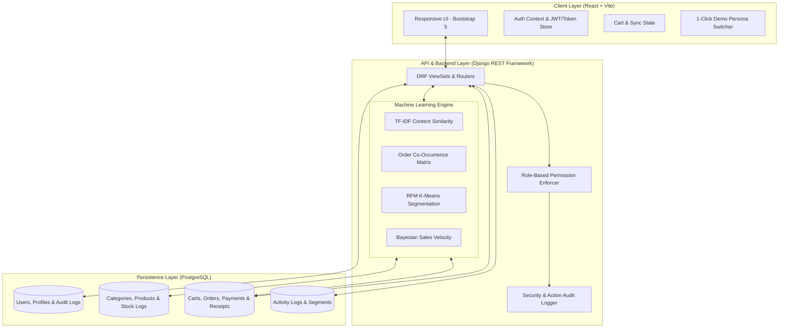

# Ethio Tech Market
## AI-Based Store Management and Online Selling System with Intelligent Product Recommendations

> **Academic Project in Information Systems / Software Engineering**  
> *An intelligent Ethiopian online technology marketplace for purchasing electronics, comparing specifications, receiving grounded AI recommendations, and managing store operations with secure Chapa payment processing.*

---

## 🌟 Executive Summary

**Ethio Tech Market** is an enterprise-grade Ethiopian e-commerce platform built specifically for the Ethiopian tech retail ecosystem. The platform integrates **Machine Learning engines (Scikit-learn and Pandas)** directly with a **PostgreSQL** relational database and **Chapa payment switch** to deliver personalized shopping experiences, dynamic product comparison, an interactive AI personal shopping assistant, and bilingual support (English & Amharic).

### 🎯 Key System Highlights

- **Role-Based Access Control (RBAC):** Three distinct personas—**Customer**, **Store Manager**, and **Administrator**—with strict backend permission guards and dynamic UI navigation.
- **Chapa Payment Gateway (Primary & Default):** Secure, server-side transaction initialization and verification via Chapa API (`ETHIO-{order.id}-{uuid}` references) supporting Telebirr, CBE Birr, Awash Bank, and debit cards without storing financial credentials.
- **AI Recommendation Engine & Assistant:**
  1. **Content-Based Similarity (TF-IDF + Cosine Similarity):** Analyzes specs, descriptions, categories, and brands to recommend contextually relevant tech alternatives.
  2. **Collaborative Association ("Frequently Bought Together"):** Co-occurrence matrix built from actual completed customer order histories.
  3. **Customer Segmentation (RFM + K-Means Clustering):** Recency, Frequency, and Monetary scores categorizing customers into interpretable behavioral clusters.
  4. **AI Personal Shopping Assistant:** Grounded natural-language tech assistant answering budget and specification questions without hallucinations.
  5. **Smart Product Comparison:** Side-by-side spec comparison of up to 4 models with AI synthesis (Best Overall, Best Value, and Verdict).
- **Bilingual Interface:** Instant language switcher supporting English and Amharic (`🇬🇧 EN` / `🇪🇹 አማ`).
- **Digital Receipts & Warranty Tracking:** Unique, verifiable digital receipts with itemized specs and warranty validity tracking from payment date.
- **Instant Role Switcher for Demonstrations:** A floating 1-click persona switcher (`Customer (Abebe)`, `Store Manager`, `Administrator`) designed specifically for project evaluation and defense demonstrations.

---

## 🛠️ Technology Stack

| Layer | Technologies |
| :--- | :--- |
| **Frontend** | React 19, Vite, JavaScript (ESNext), Bootstrap 5, Bootstrap Icons, Chart.js 4, React-Chartjs-2, Axios, React Router 7 |
| **Backend** | Python 3.12+, Django 5.2, Django REST Framework 3.18, Django-Cors-Headers |
| **Database** | PostgreSQL 18.6 (Relational DB with atomic transactions and foreign keys) |
| **Machine Learning** | Scikit-learn 1.9, Pandas 3.0, NumPy, TF-IDF Vectorizer, Cosine Similarity, K-Means Clustering |
| **Styling & UX** | Modern Vanilla CSS, Glassmorphic UI tokens, Responsive Grid, Micro-animations, Print Media Styles |

---

## 🏛️ System Architecture



---

## 🚀 Quick Start Guide

### Prerequisites
- Python 3.12+ installed
- Node.js 18+ and npm installed
- PostgreSQL installed and running on port 5432

### 1. Database Setup
Ensure PostgreSQL is running and the database exists:
```sql
CREATE DATABASE ai_online_selling_db;
```
Configure your credentials in `backend/.env` (example provided in repository).

### 2. Backend Setup
```powershell
cd backend
python -m venv .venv
.\.venv\Scripts\Activate.ps1
pip install -r requirements.txt
python manage.py migrate
python seed_data.py
python manage.py runserver 127.0.0.1:8000
```

### 3. Frontend Setup
```powershell
cd frontend
npm install
npm run dev
```
Open **`http://127.0.0.1:5173/`** in your browser.

---

## 👥 Demo Credentials

For quick evaluation during viva/presentation, use the floating **"Demo Role Switcher"** at the bottom-right of the screen, or log in manually:

| Role | Username | Password | Access Highlights |
| :--- | :--- | :--- | :--- |
| **Customer** | `abebe` | `customer123` | Browse catalog, AI assistant, Product comparison, Cart, Checkout with Chapa, View digital receipts |
| **Store Manager** | `manager` | `manager123` | Analytics dashboard, Verify payments, Update order statuses, Adjust inventory, View K-Means customer segments |
| **Administrator** | `admin` | `admin123` | Manage user accounts, assign roles, view system-wide audit logs |

---

## 🧪 Verification & Automated Testing

Run the automated test runner to test all 13 core end-to-end endpoints:
```powershell
cd backend
.\.venv\Scripts\python.exe test_all_endpoints.py
```
**Result:** 13/13 Integration tests passing (Authentication, Product Catalog, TF-IDF Recommendations, Co-Occurrence Matrix, K-Means Clustering, Cart/Checkout, Payment Upload, Manager Verification, Digital Receipt, Dashboard Metrics, Audit Logs).

---

## 📚 Project Documentation

- [System Architecture & ML Model Details](file:///documentation/ARCHITECTURE.md)
- [Step-by-Step Run & Installation Guide](file:///documentation/RUN_INSTRUCTIONS.md)
- [Full Cloud Deployment Guide (Render)](file:///documentation/DEPLOYMENT_GUIDE.md)
- [University Viva & Presentation Defense Guide](file:///documentation/PRESENTATION_GUIDE.md)

---
*Developed with pride for the Information Systems Final-Year Degree Examination.*
