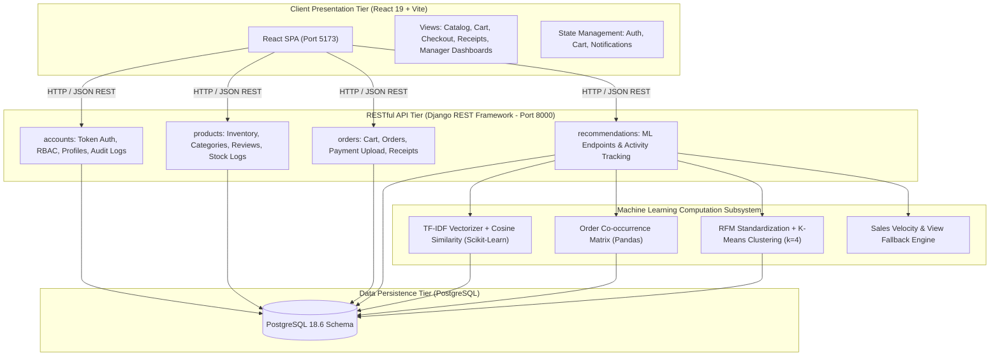
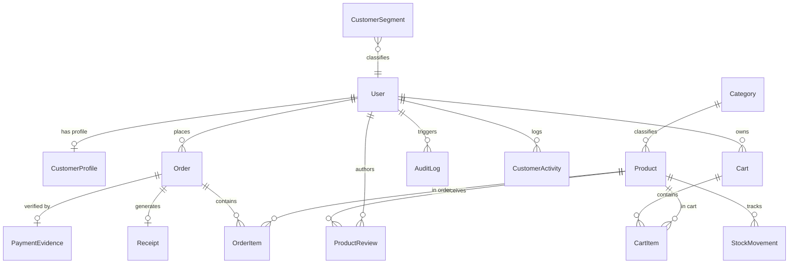
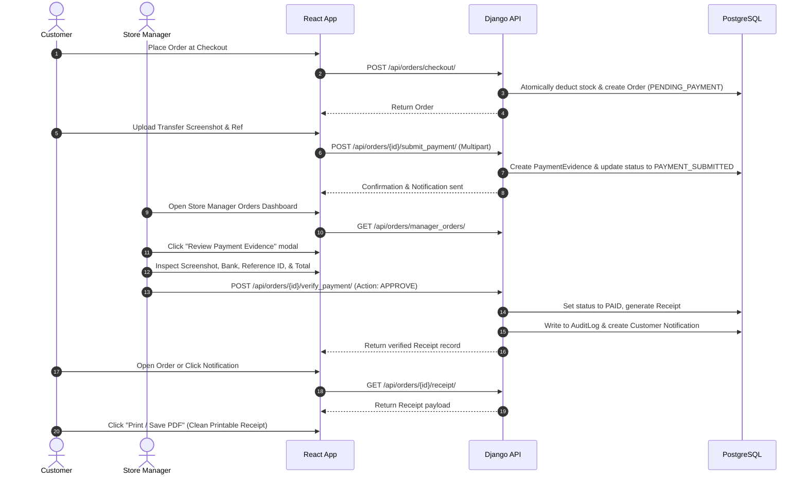

# System Architecture & Technical Specifications

> **Project:** AI-Based Store Management & Online Selling System with Intelligent Product Recommendation  
> **Target:** Final-Year Information Systems Academic Defense  

---

## 1. Architectural Overview

The application follows a modern **three-tier client-server architectural pattern** with an integrated **Machine Learning computational service**:

1. **Presentation Layer (Frontend):** A Single Page Application (SPA) built with **React 19**, **Vite**, **Bootstrap 5**, and modern CSS custom properties. It manages UI state through React Contexts (`AuthContext`, `CartContext`, `NotificationContext`) and communicates with the backend asynchronously using Axios over JSON/REST.
2. **Application & Business Logic Layer (Backend):** Built with **Django 5.2** and **Django REST Framework (DRF) 3.18**. It enforces Role-Based Access Control (RBAC), manages state transitions (e.g. order checkout, stock movements, payment approvals), and executes audit logging.
3. **Machine Learning & Analytics Subsystem:** Powered by **Python, Scikit-learn, and Pandas**. It processes real-time catalog data, historical order items, and user interaction signals from the database to compute recommendations and segment customer behavioral patterns.
4. **Data Persistence Layer (Database):** **PostgreSQL 18.6** acting as the single source of truth, enforcing ACID transactions, foreign key constraints, cascading deletes where appropriate, and unique business indexes.

---

## 2. Database Schema & Entity Relationship Diagram (ERD)

The database schema is organized across four Django applications and fifteen relational models, maintaining strict relational integrity.

### Table Definitions

| Table Name | Primary Purpose | Key Fields & Constraints |
| :--- | :--- | :--- |
| `accounts_user` | Extended user identity & role mapping | `id`, `username`, `email`, `role` (`CUSTOMER`, `STORE_MANAGER`, `ADMIN`), `phone_number` |
| `accounts_customerprofile` | Shipping and address preferences | `user_id` (1:1), `delivery_address`, `city`, `preferred_payment_method` |
| `accounts_auditlog` | Immutable compliance and security ledger | `user_id`, `action`, `resource_type`, `resource_id`, `details`, `ip_address`, `timestamp` |
| `products_category` | Hierarchical product taxonomy | `id`, `name`, `slug` (unique), `description`, `icon` |
| `products_product` | Core catalog inventory item | `id`, `category_id`, `name`, `slug` (unique), `price`, `stock_quantity`, `is_active`, `tags` |
| `products_stockmovement` | Audit trail for stock changes | `product_id`, `movement_type` (`RESTOCK`, `SALE`, `ADJUSTMENT`), `quantity`, `performed_by_id` |
| `products_productreview` | Verified buyer feedback & ratings | `product_id`, `user_id`, `rating` (1-5), `comment`, `is_approved` |
| `orders_cart` | Active persistent shopping session | `user_id` (1:1), `created_at`, `updated_at` |
| `orders_cartitem` | Line items in cart | `cart_id`, `product_id`, `quantity` |
| `orders_order` | Purchase transaction master record | `order_number` (unique), `user_id`, `total_amount`, `status`, `shipping_address`, `payment_method` |
| `orders_orderitem` | Historical snapshot of ordered items | `order_id`, `product_id`, `unit_price`, `quantity`, `subtotal` |
| `orders_paymentevidence` | Proof of manual bank transfer | `order_id` (1:1), `bank_name`, `transaction_reference`, `receipt_image`, `verification_status` |
| `orders_receipt` | Official verifiable payment receipt | `receipt_number` (unique), `order_id` (1:1), `issued_at`, `authorized_by_id`, `pdf_file` |
| `recommendations_customeractivity` | User interaction signals | `user_id`, `product_id`, `interaction_type` (`VIEW`, `CART`, `PURCHASE`, `SEARCH`), `timestamp` |
| `recommendations_customersegment` | K-Means derived clustering groups | `user_id` (1:1), `segment_name`, `recency_days`, `frequency_count`, `monetary_total`, `cluster_id` |

---

## 3. Role-Based Access Control (RBAC) Matrix

Permissions are enforced at the DRF ViewSet layer via custom permission classes (`IsStoreManager`, `IsAdminRole`, `IsCustomerOrStaff`):

| Endpoint / Capability | Public / Unauth | Customer | Store Manager | Administrator |
| :--- | :---: | :---: | :---: | :---: |
| Browse Products & Categories | ✅ | ✅ | ✅ | ✅ |
| View Product Details & Reviews | ✅ | ✅ | ✅ | ✅ |
| AI Recommendations (TF-IDF, Trending) | ✅ | ✅ | ✅ | ✅ |
| Manage Shopping Cart | ❌ | ✅ | ❌ | ❌ |
| Create Order & Checkout | ❌ | ✅ | ❌ | ❌ |
| Upload Payment Evidence (CBE/Telebirr) | ❌ | ✅ (Own orders) | ❌ | ❌ |
| View Orders & Official Receipts | ❌ | ✅ (Own orders) | ✅ (All orders) | ✅ (All orders) |
| Post Product Review | ❌ | ✅ (Verified) | ❌ | ❌ |
| Review & Verify Payment Evidence | ❌ | ❌ | ✅ | ✅ |
| Update Order Fulfillment Status | ❌ | ❌ | ✅ | ✅ |
| Add / Edit Products & Categories | ❌ | ❌ | ✅ | ✅ |
| Adjust Inventory & View Stock Logs | ❌ | ❌ | ✅ | ✅ |
| View Store Revenue Analytics & Charts | ❌ | ❌ | ✅ | ✅ |
| View AI Customer Segments (RFM) | ❌ | ❌ | ✅ | ✅ |
| Export Sales & Inventory CSV Reports | ❌ | ❌ | ✅ | ✅ |
| Manage User Accounts & Roles | ❌ | ❌ | ❌ | ✅ |
| View System Security Audit Logs | ❌ | ❌ | ❌ | ✅ |

---

## 4. Machine Learning Algorithms & Mathematical Formulation

The recommendation engine is implemented in `backend/recommendations/engine.py` and consists of three distinct mathematical components.

### 4.1 Content-Based Filtering (TF-IDF + Cosine Similarity)

Content-based filtering matches products according to their textual and categorical descriptions.

#### Formulation:
1. **Document Corpus Construction:**  
   For each product $i$, a metadata document $D_i$ is constructed by concatenating its title, category, description, brand, and search tags:
   $$D_i = \text{Category}_i \parallel \text{Name}_i \parallel \text{Description}_i \parallel \text{Tags}_i$$

2. **Term Frequency-Inverse Document Frequency (TF-IDF):**  
   $$\text{TF}(t, D_i) = \frac{f_{t, D_i}}{\sum_{t' \in D_i} f_{t', D_i}}$$
   $$\text{IDF}(t, \mathcal{D}) = \ln\left(\frac{1 + |\mathcal{D}|}{1 + |\{D \in \mathcal{D} : t \in D\}|}\right) + 1$$
   $$\text{TF-IDF}(t, D_i, \mathcal{D}) = \text{TF}(t, D_i) \times \text{IDF}(t, \mathcal{D})$$

3. **Cosine Similarity Matrix:**  
   With products represented as $L_2$-normalized vectors $\vec{v}_i$, the contextual similarity between target product $A$ and candidate product $B$ is:
   $$\text{CosineSimilarity}(\vec{v}_A, \vec{v}_B) = \frac{\vec{v}_A \cdot \vec{v}_B}{\|\vec{v}_A\| \|\vec{v}_B\|}$$
   Candidates are ranked in descending order of similarity, excluding product $A$ itself.

### 4.2 Collaborative Product Association (Order Co-Occurrence Matrix)

To identify items that are **"Frequently Bought Together"**, the system builds an association matrix across historical completed transactions.

#### Formulation:
1. Let $\mathcal{O} = \{O_1, O_2, \dots, O_m\}$ be the set of completed orders.
2. For any pair of products $(p_i, p_j)$, the co-occurrence frequency is defined as:
   $$C(p_i, p_j) = \sum_{k=1}^{m} \mathbb{I}(p_i \in O_k \land p_j \in O_k) \quad \text{where } i \neq j$$
3. The normalized association score (confidence proxy) is:
   $$\text{Score}(p_j \mid p_i) = \frac{C(p_i, p_j)}{\sum_{k} \mathbb{I}(p_i \in O_k)}$$
   The top-$N$ products with the highest association scores are returned under the *"Frequently Bought Together"* section.

### 4.3 Customer Behavioral Segmentation (RFM + K-Means Clustering)

The system automatically groups customer accounts into actionable segments using the **RFM (Recency, Frequency, Monetary)** model:

1. **Recency ($R$):** Days since the customer's most recent completed order:
   $$R_u = \Delta t(\text{current\_date}, \text{latest\_order\_date}_u)$$
2. **Frequency ($F$):** Total count of completed orders placed by user $u$:
   $$F_u = |\mathcal{O}_u|$$
3. **Monetary Value ($M$):** Total currency amount spent by user $u$:
   $$M_u = \sum_{o \in \mathcal{O}_u} \text{TotalAmount}(o)$$

#### Machine Learning Pipeline:
- **Feature Matrix:** $\mathbf{X} \in \mathbb{R}^{n \times 3}$ containing $[R_u, F_u, M_u]$ for each customer.
- **Z-Score Normalization:** Scaled using Scikit-learn's `StandardScaler`:
  $$z = \frac{x - \mu}{\sigma}$$
- **K-Means Clustering:** Minimizes the within-cluster sum of squares (inertia):
  $$\arg\min_{\mathcal{S}} \sum_{i=1}^{k} \sum_{\mathbf{x} \in S_i} \|\mathbf{x} - \boldsymbol{\mu}_i\|^2 \quad (k=4)$$
- **Cluster Label Mapping:**
  - **VIP Champions:** Low Recency, High Frequency, High Monetary.
  - **Loyal Regulars:** Moderate Recency, Moderate/High Frequency.
  - **Potential Loyalists / New Shoppers:** Very Low Recency, Low Frequency.
  - **At-Risk / Dormant:** High Recency, Low Frequency.

### 4.4 Trending / Popularity Fallback (Cold-Start Mitigation)

When a customer or product lacks interaction history (cold-start problem), the system gracefully falls back to a weighted popularity score:
$$\text{Score}_{\text{trending}}(p) = 0.5 \times \text{SalesCount}(p) + 0.3 \times \text{AvgRating}(p) + 0.2 \times \text{ViewCount}(p)$$

---

## 5. Payment Evidence & Digital Receipt Workflow

In developing markets (such as Ethiopia), manual bank transfers (Commercial Bank of Ethiopia, Telebirr, Awash Bank) are standard alongside credit cards. The system provides a complete paperless verification cycle:

---

## 6. Security & Audit Logging Implementation

1. **Password Hashing:** Django's default PBKDF2 with SHA-256 algorithm and salt.
2. **Token Authentication:** Secure Bearer tokens transmitted over authorization headers.
3. **CORS Configuration:** Explicitly whitelisted frontend origin (`http://127.0.0.1:5173`).
4. **Stock Concurrency Protection:** Checkout executes inside a Django `transaction.atomic()` block with `select_for_update()` to prevent race conditions during high-volume checkouts.
5. **Audit Logging Ledger:** Every payment verification, stock adjustment, user role change, and cancellation is immutably logged into `accounts_auditlog` with actor ID, IP address, timestamp, and metadata.
