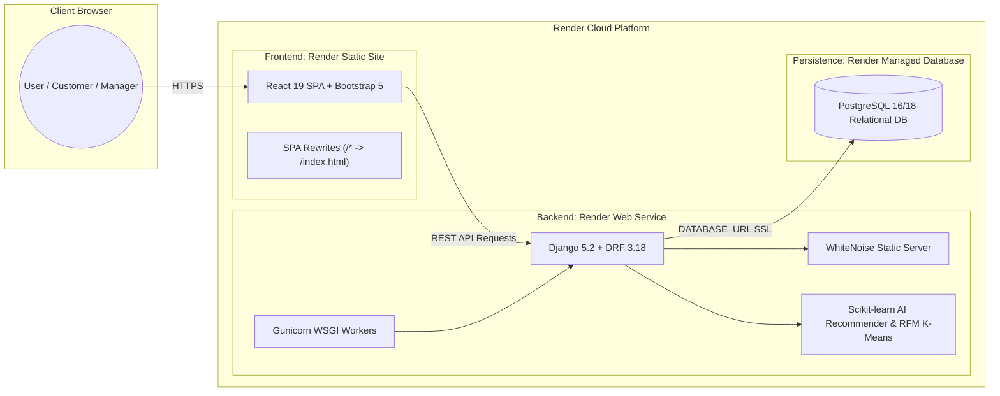

# Cloud Deployment Guide: Render (Full-Stack Production)

> **System:** AI-Based Store Management & Online Selling System with Intelligent Product Recommendation  
> **Deployment Target:** Render ([render.com](https://render.com))  
> **Architecture:** Managed PostgreSQL + Django REST Web Service (Gunicorn + WhiteNoise) + React 19 / Vite Static Site (SPA)

---

## 🌟 Overview of Production Architecture



---

## 🚀 Method 1: Automated 1-Click Blueprint Deployment (Recommended)

The repository includes a pre-configured Infrastructure-as-Code Blueprint file: [`render.yaml`](../render.yaml). This automates provisioning of the database, backend service, and frontend static site together.

### Step 1: Push Code to GitHub
Ensure all recent changes are pushed to your repository:
```powershell
git add .
git commit -m "Configure production deployment for Render"
git push origin main
```

### Step 2: Connect Repository on Render
1. Sign in or create a free account at **[dashboard.render.com](https://dashboard.render.com/)**.
2. Click the **"New +"** button in the top navigation bar.
3. Select **"Blueprint"**.
4. Connect your GitHub account and choose the repository:  
   `Ad3023/AI-Based-Store-Management-and-Online-Selling-System`.
5. Render will automatically detect [`render.yaml`](../render.yaml) and display:
   - **Database:** `ai-online-selling-db` (PostgreSQL)
   - **Web Service:** `ai-online-selling-api` (Python 3.12, Django + Gunicorn)
   - **Static Site:** `ai-online-selling-web` (Node.js, Vite + React)

### Step 3: Configure Environment Prompts & Apply
1. Fill in any required environment fields prompted on screen:
   - `CHAPA_SECRET_KEY`: *(Optional)* Your Chapa secret test key `CHAPA_TEST_PRIV_...` (or leave empty if using bank receipt evidence).
   - `VITE_API_BASE_URL`: Initially leave blank or set to your API service URL once deployed (e.g. `https://ai-online-selling-api.onrender.com/api/`).
2. Click **"Apply"**.
3. Render will concurrently:
   - Provision your managed PostgreSQL instance.
   - Run `backend/build.sh` (installs packages, runs `collectstatic`, applies migrations, and executes `seed_data.py`).
   - Run `npm install && npm run build` on the frontend.

### Step 4: Finalize Frontend API URL
1. Once `ai-online-selling-api` finishes deploying, copy its live URL (e.g. `https://ai-online-selling-api.onrender.com`).
2. Go to your `ai-online-selling-web` Static Site on Render -> **Environment** tab.
3. Add / update:
   - **`VITE_API_BASE_URL`**: `https://ai-online-selling-api.onrender.com/api/`
   - **`VITE_BACKEND_URL`**: `https://ai-online-selling-api.onrender.com`
4. Click **"Save Changes"** to trigger a quick automatic rebuild of the static frontend.

---

## 🛠️ Method 2: Manual Step-by-Step Deployment on Render

If you prefer deploying services individually rather than using the Blueprint:

### Step 2.1: Create PostgreSQL Database
1. Go to **Dashboard** -> **New +** -> **PostgreSQL**.
2. Settings:
   - **Name:** `ai-online-selling-db`
   - **Database:** `ai_online_selling_db`
   - **User:** `postgres`
   - **Region:** Frankfurt (EU Central) or Oregon (US West)
   - **Plan:** Free
3. Click **"Create Database"**.
4. Once created, copy the **Internal Database URL** (for services inside Render) or **External Database URL**.

---

### Step 2.2: Create Backend Web Service
1. Go to **Dashboard** -> **New +** -> **Web Service**.
2. Select your repository: `AI-Based-Store-Management-and-Online-Selling-System`.
3. Settings:
   - **Name:** `ai-online-selling-api`
   - **Region:** Same region as your database
   - **Branch:** `main`
   - **Root Directory:** `backend`
   - **Runtime:** `Python 3`
   - **Build Command:** `bash build.sh`
   - **Start Command:** `gunicorn config.wsgi:application --bind 0.0.0.0:$PORT`
   - **Plan:** Free
4. Under **Environment Variables**, add:
   | Key | Value | Notes |
   | :--- | :--- | :--- |
   | `PYTHON_VERSION` | `3.12.8` | Ensures Python 3.12 runtime |
   | `DATABASE_URL` | `<paste your Render Postgres Internal Connection URL>` | Auto-configures PostgreSQL |
   | `DEBUG` | `False` | Production security |
   | `SECRET_KEY` | *(Click 'Generate')* | Random cryptographic key |
   | `ALLOWED_HOSTS` | `*` | Or your Render domain |
   | `CORS_ALLOW_ALL_ORIGINS` | `True` | Allows cross-origin API calls |
   | `CHAPA_SECRET_KEY` | `CHAPA_TEST_PRIV_...` | Optional payment gateway key |
5. Click **"Create Web Service"**.
6. Monitor the deployment logs. Render will execute `build.sh`:
   - Dependencies installed (`pip install -r requirements.txt`)
   - Assets collected (`collectstatic`)
   - Migrations executed (`migrate`)
   - Database populated (`seed_data.py`)

---

### Step 2.3: Create Frontend Static Site
1. Go to **Dashboard** -> **New +** -> **Static Site**.
2. Select your repository: `AI-Based-Store-Management-and-Online-Selling-System`.
3. Settings:
   - **Name:** `ai-online-selling-web`
   - **Branch:** `main`
   - **Root Directory:** `frontend`
   - **Build Command:** `npm install && npm run build`
   - **Publish Directory:** `dist`
4. Under **Redirects/Rewrites**, add a rewrite rule:
   - **Type:** `Rewrite`
   - **Source:** `/*`
   - **Destination:** `/index.html`
   *(This ensures client-side routing like `/shop`, `/cart`, and `/manager/dashboard` works when refreshed).*
5. Under **Environment Variables**, add:
   | Key | Value |
   | :--- | :--- |
   | `VITE_API_BASE_URL` | `https://ai-online-selling-api.onrender.com/api/` |
   | `VITE_BACKEND_URL` | `https://ai-online-selling-api.onrender.com` |
6. Click **"Create Static Site"**.

---

## 👥 Production Demo Credentials

Once deployed, you can access your site at `https://ai-online-selling-web.onrender.com` and use the 1-click **Demo Role Switcher** or log in manually:

| Role | Username | Password | Production Access Scope |
| :--- | :--- | :--- | :--- |
| **Customer** | `abebe` | `customer123` | Product catalog, AI TF-IDF recommendations, Cart, CBE/Telebirr receipt upload, printable invoice |
| **Store Manager** | `manager` | `manager123` | Financial metrics, payment approval, order processing, RFM K-Means customer segmentation |
| **Administrator** | `admin` | `admin123` | User account administration, role assignment, system security audit logs |

---

## 🔍 Verification & Health Checks

1. **Verify Backend Health:**
   Open in your browser:
   `https://<your-api-domain>.onrender.com/api/products/`
   *Expected response:* JSON payload containing active products and pagination metadata.

2. **Verify Recommendations Engine:**
   `https://<your-api-domain>.onrender.com/api/recommendations/content-based/?product_id=1`
   *Expected response:* Array of recommended products ranked by TF-IDF cosine similarity.

3. **Verify Frontend Access:**
   Visit `https://<your-frontend-domain>.onrender.com/`
   *Expected response:* Full landing page loads, products display images, and the Demo Role Switcher functions smoothly.

---

## 💡 Performance & Free Tier Considerations

- **Render Free Tier Spin-Down:** Render free web services go to sleep after 15 minutes of inactivity. When a new request arrives, it may take 30–50 seconds for the first request (cold start) while the container wakes up. Subsequent requests are instant.
- **Media Uploads:** On Render's free tier, local storage is ephemeral. To persist payment receipt screenshots permanently across dyno restarts in full production, you can connect an S3 bucket or Cloudinary in `settings.py`.
